# Sơ đồ Activity và Deployment — Museum Audio Guide

Phân tích repository [Chauthienhao/Seminar](https://github.com/Chauthienhao/Seminar), commit `8c484cdf93f529af73ff7737e84cb35d825c215c`, ngày 20/10/2026. Sơ đồ mô tả code tại commit này, không khẳng định hệ thống đã được triển khai trên máy chủ thật.

## Cách đọc

- **Đã có**: logic thực sự tồn tại trong source; không đồng nghĩa đã kiểm thử chạy thực tế.
- **API chưa nối UI**: backend có endpoint nhưng trang React chưa gọi.
- **Dự kiến / đề xuất**: chưa có implementation hoặc cấu hình deployment trong repository; đường nét đứt trong Deployment.
- Activity dùng Mermaid flowchart với nút bắt đầu/kết thúc, quyết định và vùng trách nhiệm. File `deployment.puml` dùng ký pháp UML Deployment chính thức, có node, execution environment, artifact và communication path.

Các file `.mmd` là mã sơ đồ chỉnh sửa được; `.svg` là bản vector đã render. Mở `index.html` để duyệt toàn bộ sơ đồ và phóng to bằng trình duyệt.

## 1. Phạm vi và mức độ hoàn thiện

| Thành phần | Trạng thái thực tế | Bằng chứng |
|---|---|---|
| React 18 + React Router 6 + Vite 5 + Tailwind | Có source frontend | `package.json`, `src/App.jsx` |
| Tra cứu khách | Lọc 3 phần tử mẫu trong bộ nhớ; submit điều hướng bằng slug/chuỗi nhập | `src/pages/ArtifactLookup.jsx` |
| Chi tiết hiện vật | Dùng duy nhất hằng `ARTIFACT`; id chỉ hiển thị | `src/pages/ArtifactDetail.jsx` |
| Phát audio | Chỉ toggle `playing`; không có HTMLAudioElement, thẻ audio, TTS client hay log client | `ArtifactDetail.jsx` |
| Đổi ngôn ngữ | Chỉ thay state/nút được chọn; chưa dịch nội dung hoặc đồng bộ Header | `Header.jsx`, `ArtifactDetail.jsx` |
| Bản đồ | Hai tầng hardcode; current/next/routePath là dữ liệu mẫu | `MuseumMap.jsx` |
| Tour | Lọc 3 tour mẫu theo tiêu đề/chủ đề; link fragment, chưa có route chi tiết tour | `ToursCollections.jsx` |
| CMS | Đăng nhập, lưu token sessionStorage, gọi me + top-played, đăng xuất | `AdminDashboard.jsx` |
| API visitor/admin | Có router, service, repository, ORM, schema | `backend-thuyet-minh/` |
| Mobile QR/GPS | Chưa có project React Native/camera/GPS client | Chỉ được nhắc trong comment/UI |
| TTS | Backend chỉ ghép URL `/synthesize`; không gửi HTTP tới TTS | `AudioService._resolve_audio` |
| Media server | Chỉ lưu URL; chưa có upload, static mount hoặc server stream | `main.py`, `entities.py` |
| Production/CI/CD | Chưa có Dockerfile, compose, pipeline, ingress, cloud manifest | Cây file repository |

## 2. Activity A01 — Khách tham quan trên giao diện hiện tại

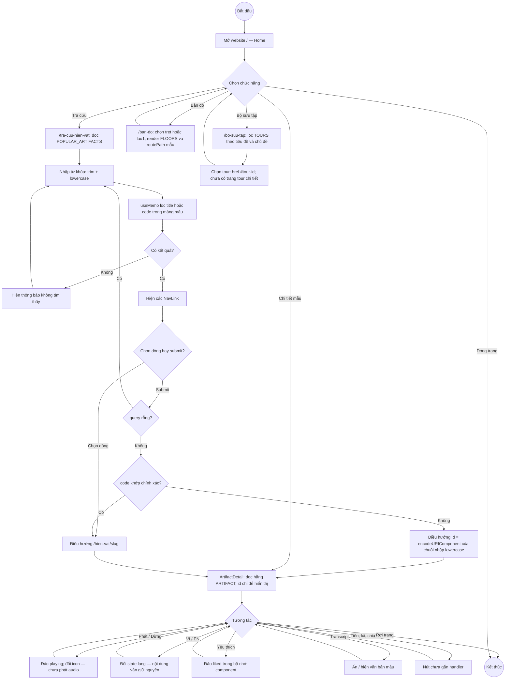

Không có request API visitor nào trong luồng này. Tìm không thấy mã vẫn có thể mở trang chi tiết mẫu. Không nên trình bày thao tác này như một lần tra cứu thành công từ CSDL.

## 3. Activity A02 — API tìm kiếm, lookup QR và chi tiết hiện vật

API đã có, giao diện khách chưa nối. Swimlane thể hiện ranh giới giữa HTTP, service và CSDL.

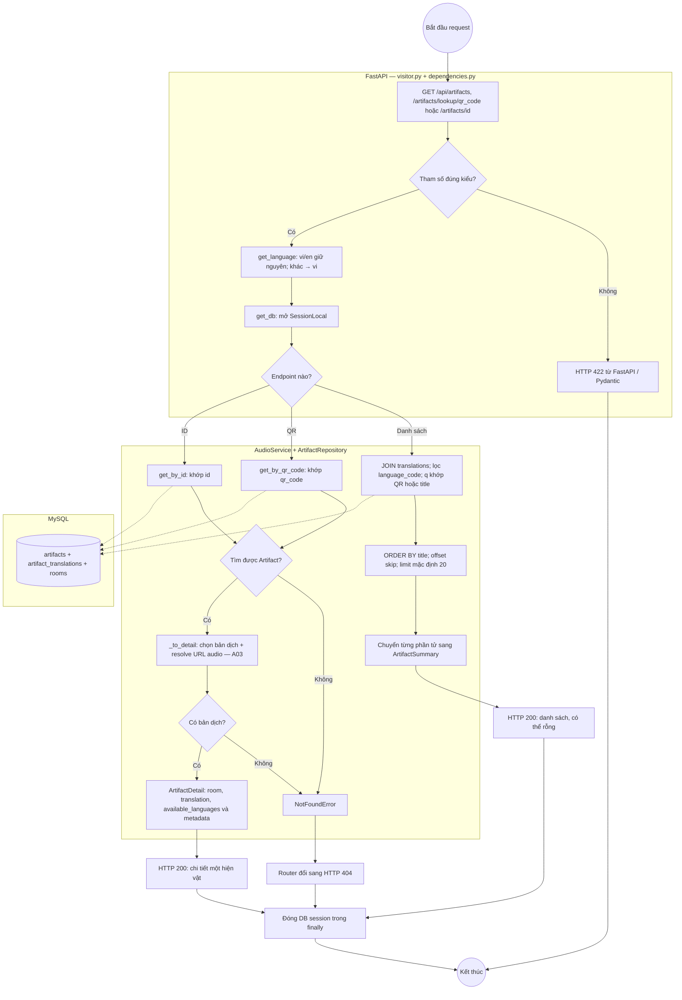

Danh sách tìm kiếm chỉ lấy hiện vật có translation đúng ngôn ngữ; không dùng fallback ngôn ngữ cho bước lọc SQL. `skip/limit` chưa được khai báo ràng buộc số không âm. Ngoại lệ CSDL chưa có handler nghiệp vụ riêng; có thể trở thành lỗi server. Trường hợp lỗi sau khi mở session vẫn thực hiện `finally` đóng session.

## 4. Activity A03 — Chọn bản dịch và nguồn thuyết minh

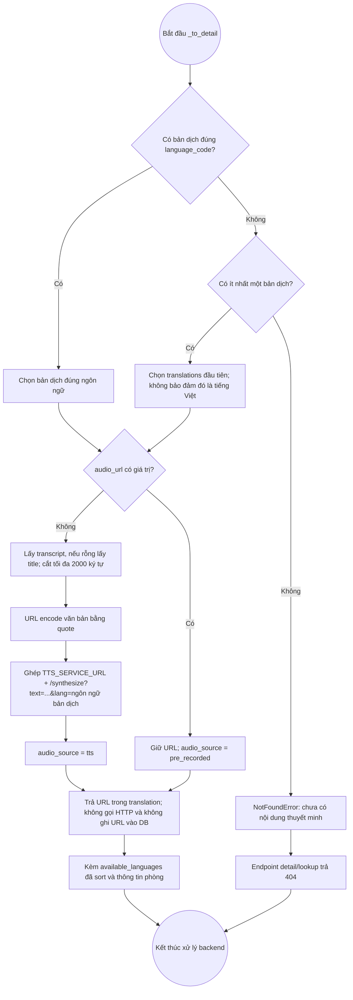

Đây là **resolve URL**, chưa phải hoạt động tổng hợp/phát tiếng nói. Repo chưa có implementation `/synthesize`, hàng đợi audio, chống phát trùng, tự dừng hay retry TTS. Client trong tương lai phải truy cập trực tiếp URL được trả về; `localhost:8001` chỉ đúng khi dịch vụ nằm trên chính máy chạy client.

## 5. Activity A04 — Ghi log lượt nghe

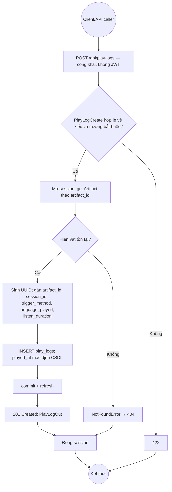

UI hiện chưa gọi endpoint này. Mỗi POST tạo một dòng mới; không có upsert, chống trùng hay ghép sự kiện bắt đầu/kết thúc. `trigger_method` và `language_played` là chuỗi tự do; `listen_duration` chưa có ràng buộc không âm. Do đó `play_count` là số dòng log, chưa bảo đảm là số phiên nghe duy nhất.

## 6. Activity A05 — Đăng nhập, tải Dashboard và đăng xuất CMS

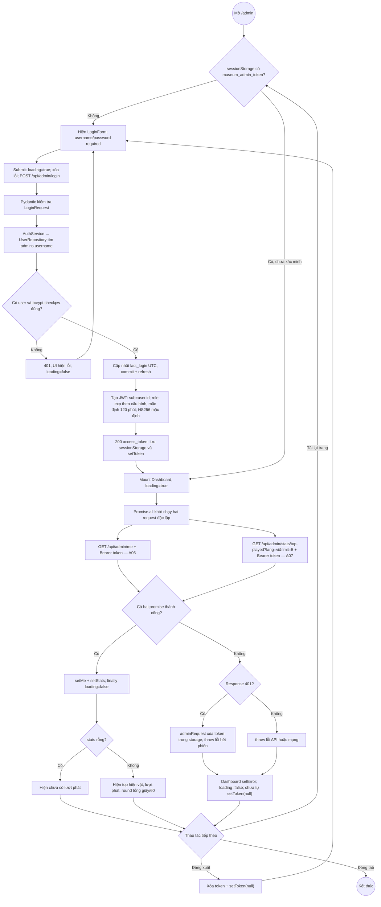

401 trong request dashboard xóa sessionStorage nhưng không cập nhật state token ở component cha, nên UI chưa tự quay về form ngay. Đăng xuất chỉ xóa token phía browser, chưa có API revoke token. `Promise.all` là xử lý song song; việc một request lỗi không tự hủy request còn lại. `App.jsx` vẫn bọc `/admin` bằng Header/Footer chung dù comment trong CMS nói khác.

## 7. Activity A06 — Cổng xác thực cho các API quản trị

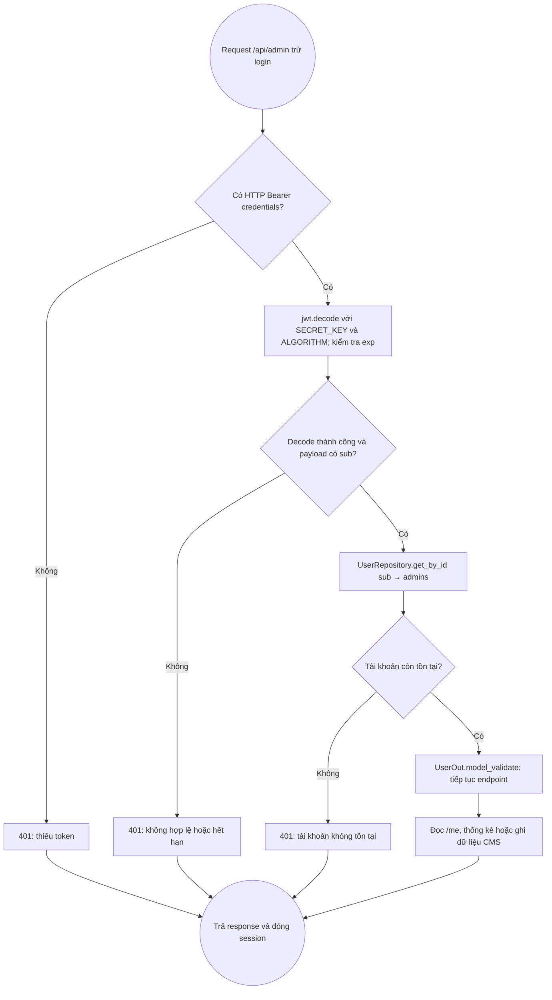

`require_super_admin` có định nghĩa nhánh 403 nhưng **chưa được router nào sử dụng**. Các API CMS hiện chỉ đòi tài khoản hợp lệ; chưa phân biệt quyền STAFF/SUPER_ADMIN cho thao tác CRUD. Không thêm nhánh phân quyền 403 vào luồng đang chạy.

## 8. Activity A07 — Thống kê Top hiện vật

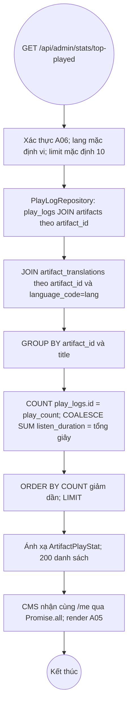

`lang` của endpoint thống kê không qua `get_language`, không tự chuẩn hóa về vi. Lọc ngôn ngữ áp dụng cho **tiêu đề bản dịch**, không lọc `play_logs.language_played`: lượt phát đang cộng tất cả ngôn ngữ. INNER JOIN bỏ log có `artifact_id=NULL` hoặc hiện vật thiếu bản dịch theo lang. Nếu một hiện vật có nhiều bản dịch cùng language_code thì phép JOIN có thể nhân dòng log; DB chưa có unique constraint cho cặp này.

## 9. Activity A08 — Tạo, sửa, xóa hiện vật qua API CMS

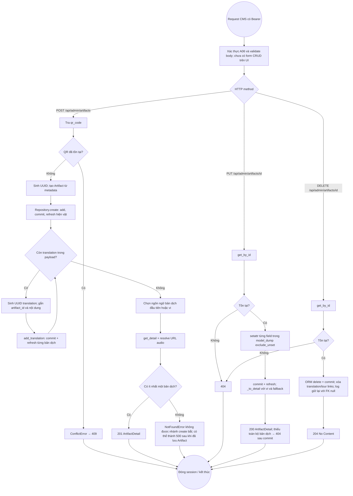

PUT chỉ sửa `room_id, lat, lng, geofence_radius, image_url, period`; chưa sửa được QR hoặc translation. Tạo hiện vật và từng translation được commit riêng, không phải một transaction nguyên tử; lỗi ở bước sau có thể để lại dữ liệu đã ghi. Ngoại lệ FK/IntegrityError chưa được chuyển thành 409/422. Không có upload file audio; payload chỉ nhận URL.

## 10. Activity A09 — Phòng và tour công khai qua API

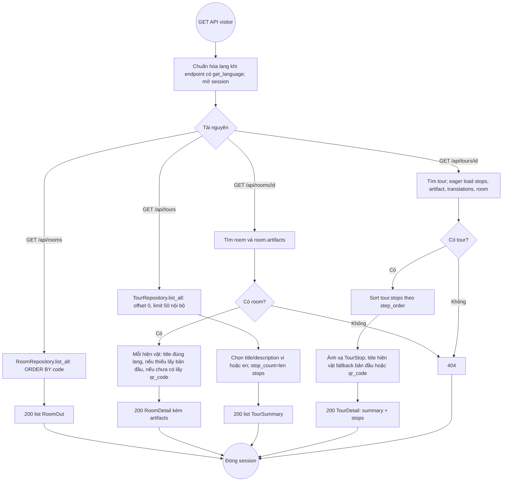

Các API này chưa được MuseumMap/ToursCollections gọi. Backend chưa có API dữ liệu hình học mặt bằng theo tầng, định tuyến đường đi, tiến độ tham quan hoặc bộ lọc tour `q/topic` như UI mẫu.

## 11. Activity A10 — Tạo phòng, tạo/xóa tour qua API CMS

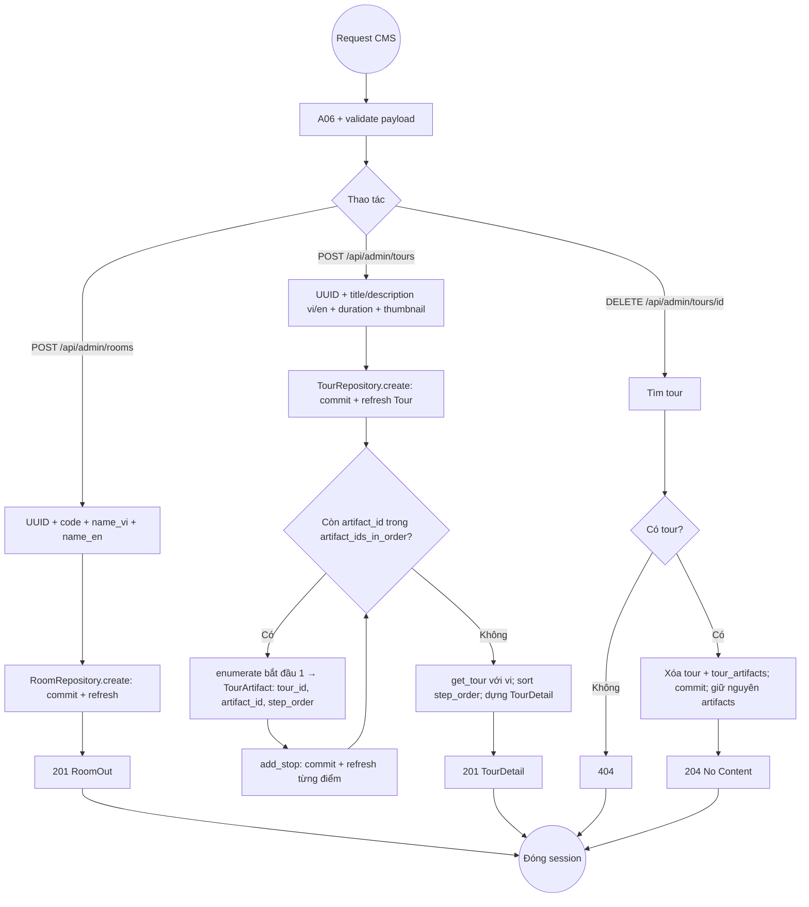

Chưa có PUT tour; chưa có PUT/DELETE room trong router dù repository có hàm tương ứng. Tạo tour commit nhiều lần; artifact_id không tồn tại hoặc trùng trong cùng tour có thể lỗi FK/PK sau khi Tour đã được lưu. Chưa có transaction gộp, validate tồn tại từng điểm hay ánh xạ lỗi này thành response nghiệp vụ.

## 12. Activity A11 — Tìm hiện vật gần nhất theo geofence

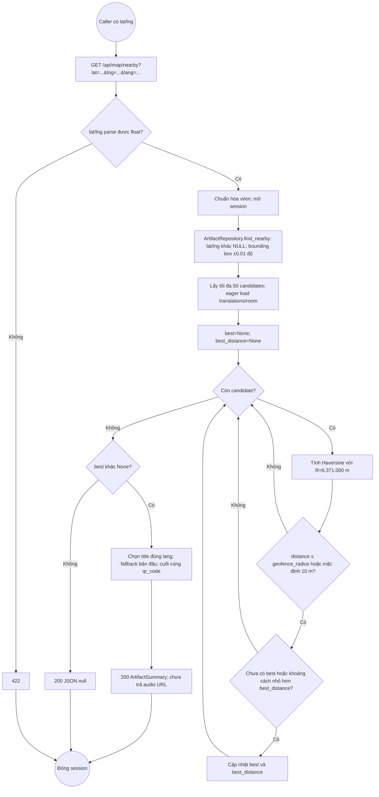

Chưa có client xin quyền GPS, cập nhật vị trí, gọi detail sau nearby hoặc tự phát audio. API không validate miền lat/lng địa lý, không xét tầng/tường và không có cooldown/hysteresis. Giới hạn 50 ứng viên trước khi tính khoảng cách có thể bỏ sót hiện vật gần nhất trong vùng đông dữ liệu; không bảo đảm gần nhất toàn bộ CSDL.

## 13. Deployment D01 — Cấu hình local suy ra trực tiếp từ source

Đây là topology chạy phát triển được code hướng tới. Các execution environment có thể cùng nằm trên một máy; vị trí máy vật lý thực tế chưa được khai báo. Các lớp router/service/repository **cùng một tiến trình backend**, không phải các microservice riêng.

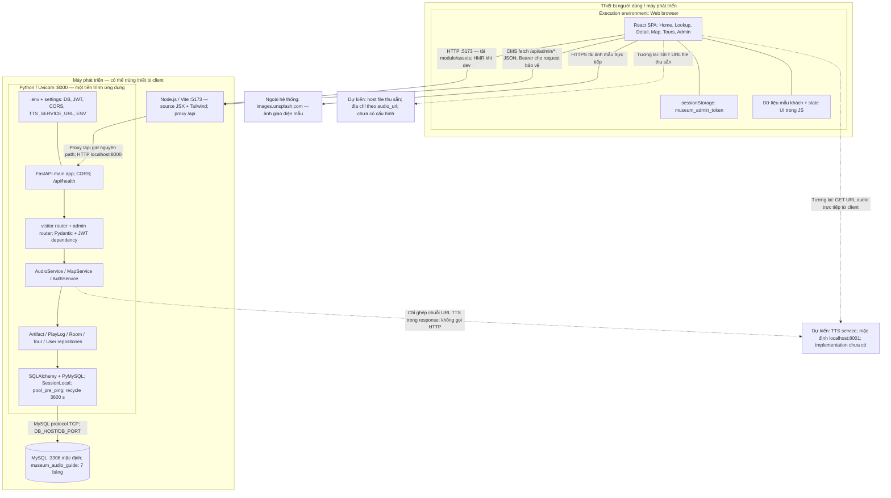

MySQL gồm `rooms`, `artifacts`, `artifact_translations`, `tours`, `tour_artifacts`, `play_logs`, `admins`. Nội dung audio và ảnh được tham chiếu bằng URL; không lưu byte media trong DB.

## 14. Deployment D02 — Phương án production đề xuất, chưa có trong source

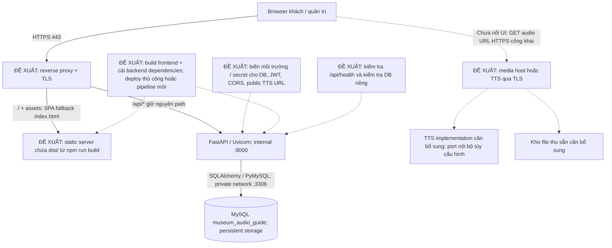

`server.proxy` của Vite chỉ có tác dụng dev, không được nhúng vào bundle `dist/`. Vì CMS dùng `/api/admin` tương đối, production phải route đường dẫn này về backend cùng origin hoặc thay code cấu hình API origin. BrowserRouter cần SPA fallback cho truy cập trực tiếp `/admin`, `/ban-do`, `/hien-vat/...`.

`TTS_SERVICE_URL` được đưa ra response để client dùng, nên production cần URL client truy cập được, không dùng tên host chỉ có trong mạng nội bộ. Media/TTS qua HTTPS tránh mixed content khi website chạy HTTPS. Chưa có cơ sở từ source để khẳng định AWS, Azure, Docker, Kubernetes, Nginx, CDN, load balancer hoặc CI/CD đang được sử dụng.

## 15. Activity A12 — Quy trình triển khai và xác minh đề xuất

Luồng này là hướng dẫn triển khai rút ra từ phụ thuộc source, **không phải pipeline sẵn có**.

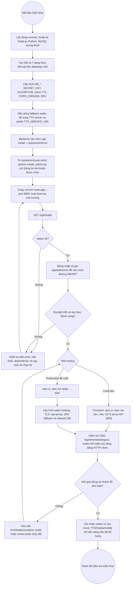

`/api/health` hiện chỉ trả `status` và `env`, không truy vấn DB/TTS; response OK chưa đủ kết luận toàn hệ thống hoạt động. `DB.sql` dùng `CREATE TABLE` không có `IF NOT EXISTS`, không phải migration có thể chạy lặp tùy ý. `create_admin.py` nằm trực tiếp trong thư mục backend; comment `python -m scripts.create_admin` trong file không khớp cây thư mục hiện tại.

## 16. Danh mục endpoint đối chiếu

Mọi đường dẫn sau có prefix `/api`. Ngoại trừ login, endpoint `/admin/*` đều dùng `get_current_user`.

| Method | Path | Dữ liệu / xử lý | Response nghiệp vụ chính |
|---|---|---|---|
| GET | `/health` | Không DB | 200 status/env |
| GET | `/artifacts` | q, lang, skip=0, limit=20 | 200 list |
| GET | `/artifacts/lookup/{qr_code}` | QR + lang | 200 / 404 |
| GET | `/artifacts/{artifact_id}` | ID + lang | 200 / 404 |
| POST | `/play-logs` | PlayLogCreate | 201 / 404 |
| GET | `/rooms` | Tất cả phòng theo code | 200 |
| GET | `/rooms/{room_id}` | Phòng + hiện vật | 200 / 404 |
| GET | `/map/nearby` | lat, lng, lang | 200 summary hoặc null |
| GET | `/tours` | lang | 200 |
| GET | `/tours/{tour_id}` | lang | 200 / 404 |
| POST | `/admin/login` | username, password | 200 JWT / 401 |
| GET | `/admin/me` | Bearer token | 200 / 401 |
| POST | `/admin/artifacts` | ArtifactCreate | 201 / 409 |
| PUT | `/admin/artifacts/{artifact_id}` | ArtifactUpdate | 200 / 404 |
| DELETE | `/admin/artifacts/{artifact_id}` | ID | 204 / 404 |
| POST | `/admin/rooms` | RoomCreate | 201 |
| POST | `/admin/tours` | TourCreate | 201 |
| DELETE | `/admin/tours/{tour_id}` | ID | 204 / 404 |
| GET | `/admin/stats/top-played` | lang=vi, limit=10 | 200 |

API có schema/query parameter sai kiểu có thể trả 422; API bảo vệ có thể trả 401 trước xử lý nghiệp vụ. Lỗi không được bắt, lỗi DB hoặc lỗi response validation có thể thành 500; bảng trên không khẳng định mọi lỗi đều được xử lý hoàn chỉnh.

## 17. Nguồn đối chiếu theo commit

Các nhận xét được rút từ implementation, ưu tiên code thực thi hơn README/comment cũ.

- [Frontend routes](https://github.com/Chauthienhao/Seminar/blob/8c484cdf93f529af73ff7737e84cb35d825c215c/src/App.jsx), [Lookup](https://github.com/Chauthienhao/Seminar/blob/8c484cdf93f529af73ff7737e84cb35d825c215c/src/pages/ArtifactLookup.jsx), [Detail](https://github.com/Chauthienhao/Seminar/blob/8c484cdf93f529af73ff7737e84cb35d825c215c/src/pages/ArtifactDetail.jsx).
- [Map UI](https://github.com/Chauthienhao/Seminar/blob/8c484cdf93f529af73ff7737e84cb35d825c215c/src/pages/MuseumMap.jsx), [Tours UI](https://github.com/Chauthienhao/Seminar/blob/8c484cdf93f529af73ff7737e84cb35d825c215c/src/pages/ToursCollections.jsx), [CMS UI](https://github.com/Chauthienhao/Seminar/blob/8c484cdf93f529af73ff7737e84cb35d825c215c/src/pages/admin/AdminDashboard.jsx).
- [Visitor endpoints](https://github.com/Chauthienhao/Seminar/blob/8c484cdf93f529af73ff7737e84cb35d825c215c/backend-thuyet-minh/api/routers/visitor.py), [Admin endpoints](https://github.com/Chauthienhao/Seminar/blob/8c484cdf93f529af73ff7737e84cb35d825c215c/backend-thuyet-minh/api/routers/admin.py), [JWT dependencies](https://github.com/Chauthienhao/Seminar/blob/8c484cdf93f529af73ff7737e84cb35d825c215c/backend-thuyet-minh/api/dependencies.py).
- [Audio service](https://github.com/Chauthienhao/Seminar/blob/8c484cdf93f529af73ff7737e84cb35d825c215c/backend-thuyet-minh/services/audio_service.py), [Map service](https://github.com/Chauthienhao/Seminar/blob/8c484cdf93f529af73ff7737e84cb35d825c215c/backend-thuyet-minh/services/map_service.py), [Auth service](https://github.com/Chauthienhao/Seminar/blob/8c484cdf93f529af73ff7737e84cb35d825c215c/backend-thuyet-minh/services/auth_service.py).
- [DB DDL](https://github.com/Chauthienhao/Seminar/blob/8c484cdf93f529af73ff7737e84cb35d825c215c/DB.sql), [Vite proxy](https://github.com/Chauthienhao/Seminar/blob/8c484cdf93f529af73ff7737e84cb35d825c215c/vite.config.js), [Backend entry](https://github.com/Chauthienhao/Seminar/blob/8c484cdf93f529af73ff7737e84cb35d825c215c/backend-thuyet-minh/main.py), [Settings](https://github.com/Chauthienhao/Seminar/blob/8c484cdf93f529af73ff7737e84cb35d825c215c/backend-thuyet-minh/core/config.py).
